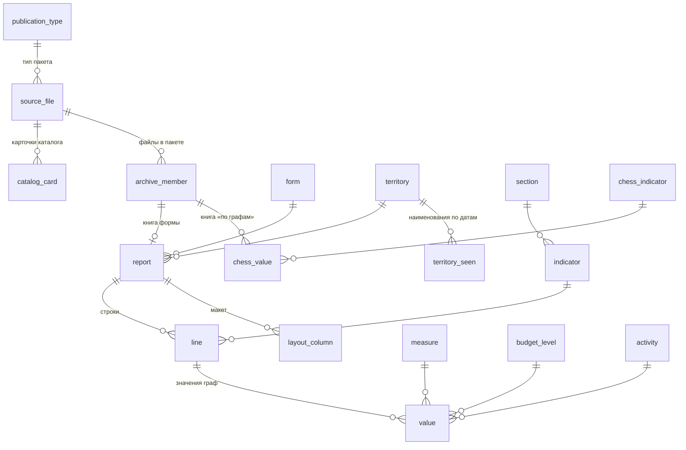

# База данных

DuckDB-файл `data/db/roskazna_kbs.duckdb` (≈ 4,6 ГБ, собирается командой `build`, в git не
хранится) и выгрузка в Parquet `data/export/` (≈ 1,8 ГБ, команда `export`). DDL —
[sql/schema.sql](../sql/schema.sql), витрины — [sql/views.sql](../sql/views.sql),
справочники форм и разделов — [sql/dicts/](../sql/dicts/). Что лежит в исходных файлах —
[files.md](files.md) и [forms/](forms/README.md).

## Принципы

1. **Длинный формат.** Одно значение = одна строка `value`: строка отчёта (`line_id`) ×
   графа (`graph`) с расшифровкой — показатель (`measure`), уровень бюджета
   (`budget_level`), вид деятельности (`activity`, только макеты 2005–2013 гг.). Набор граф
   меняется от формы к форме и от года к году, длинный формат хранит их все без пропусков.
   Широкие витрины `v_0503317_*` собирают основные графы в колонки.
2. **Классификация граф по тексту шапки.** Номер графы меняется от макета к макету;
   показатель и уровень бюджета определяются по тексту шапки (`src/roskazna_kbs/dims.py`).
   Исходный текст — `layout_column.header`, сводка — `v_layout_catalog`.
3. **Показатель — общий для отчётов.** Строки разных отчётов с одинаковыми формой,
   разделом, кодом строки, наименованием и кодами классификации ссылаются на один
   `indicator_id`: ряды по территориям и датам строятся без сопоставления текстов.
4. **Рубли.** `value` — `DECIMAL(18,2)` в рублях. Отчёты в тыс. руб. (до 2005 г.) умножены
   на `report.unit_multiplier`; исходная единица — `report.unit_raw`.
5. **Нули не хранятся.** Пустая графа и «0,00» в источнике неразличимы по смыслу (в разных
   макетах пустые графы заполнены по-разному). Отсутствие значения = 0. Какие графы были в
   макете отчёта — видно в `layout_column`.
6. **Коды — строки.** Ведущие нули и буквы сохраняются (`10101012020000110`, `24A`).
   «х» в кодовой графе — признак итога (`indicator.is_total_marker`), а не код.
7. **Происхождение каждой цифры** прослеживается до файла: `value → line (sheet_name,
   row_no) → report (member_path) → archive_member → source_file (url, sha256)`.

## Схема



Слои: справочники → происхождение (`catalog_card`, `source_file`, `archive_member`,
`report`) → факты отчётов (`indicator`, `line`, `value`, `layout_column`) → сводные данные
«шахматок» (`chess_indicator`, `chess_value`) → витрины `v_*`.

## Ключи

| Ключ | Как устроен | Стабильность |
|---|---|---|
| `source_file.package_no` | номер пакета, присваивается при первой загрузке (`data/catalog/files.csv`) | постоянный |
| `source_file.file_id` | `sha1(file_path)[:12]` | постоянный, пока не сменился путь на портале |
| `report.report_id` | `package_no * 10000 + № книги в пакете` | пока не изменился пакет |
| `line.line_id` | `report_id * 100000 + line_no` | то же |
| `indicator.indicator_id` | 63-битный хеш атрибутов показателя (форма, раздел, код строки, наименование, коды) | постоянный |
| `archive_member.member_id` | `<file_id>:<i>[:<j>…]` — индексы во вложенных архивах | пока не изменился пакет |

Естественный ключ отчёта: `(form_code, report_date, territory_code, activity)` плюс пакет.
Один и тот же отчёт может прийти в нескольких пакетах (срез на 1 января — в месячном и
годовом; годовой пакет 2007 г. содержит все месячные отчёты; своды 2013–2015 гг. — в XLS и
HTML). Витрина `v_report` помечает предпочтительную версию `is_preferred`: годовой пакет →
годовая форма `Mes_428y` → более поздний пакет → первая книга пакета; отчёт без вида
деятельности и отчёт «бюджетной деятельности» считаются одним отчётом.

## Справочники

| Таблица | Ключ | Содержание |
|---|---|---|
| `publication_type` | `publication_type` | `monthly` (фильтр портала 48), `annual` (49) |
| `form` | `form_code` | 0503317, 0503320, 0503321, 0503323, 0524100 |
| `section` | `section` | разделы форм (см. ниже) |
| `measure` | `measure` | показатель графы |
| `budget_level` | `budget_level` | уровень бюджета, `sort_order` — порядок граф в форме |
| `activity` | `activity` | `total`, `budget`, `income_generating` |
| `territory` | `territory_code` | код Казначейства → последнее наименование, федеральный округ, период отчётности |
| `territory_seen` | — | все пары «код → наименование» по датам и источникам (`terrlist`, `chess`, `report_header`); состав федеральных округов |

### Разделы (`section`)

| Раздел | Форма | Содержание |
|---|---|---|
| `income` | 0503317, 0524100 | доходы |
| `expense` | 0503317, 0524100 | расходы; строка 450 — результат исполнения |
| `sources` | 0503317, 0524100 | источники финансирования дефицита |
| `settlements` | 0503317 | таблица консолидируемых расчётов (с 2012 г.) |
| `summary` | 0503317, 0524100 | одна сводная таблица HTML 2000–2006 гг. |
| `expense_detail` | 0524100 | расходы по подразделам (листы `R-NN-ot`) |
| `balance`, `offbalance`, `obligations` | 0503320 | баланс, справка о забалансовых счетах, таблица обязательств |
| `results`, `results_changes` | 0503321 | финансовые результаты; изменение расчётов между бюджетами |
| `cash_flows`, `cash_outflows_detail` | 0503323 | движение денежных средств; выбытия по разделам |

### Показатели (`measure`)

| Код | Показатель | Где |
|---|---|---|
| `approved` | утверждённые бюджетные назначения | 0503317, 0524100 |
| `executed` | исполнено (кассовое исполнение нарастающим итогом с начала года) | 0503317, 0524100, «шахматки» |
| `begin_balance`, `end_balance` | на начало года / на конец отчётного периода | 0503320 |
| `inflow` | поступления (бюджет-получатель) | 0503317 разд. 4, 0503320 таблица, 0503321 лист 2 |
| `obligations` | обязательства | 0503320 таблица |
| `income_change`, `expense_change` | доходы / расходы по изменению расчётов | 0503321 лист 2 (с 2020 г.) |
| `amount` | сумма — шапка не называет показатель | 0503321, 0503323, справка 0503320 за 2005 г. |
| `other` | заголовок графы не распознан (сейчас не встречается) | — |

### Уровни бюджета (`budget_level`)

| Код | Уровень | Годы (срез) |
|---|---|---|
| `cons_subject_tgvf` | консолидированный бюджет субъекта и бюджет ТГВФ — итог формы | 2006–2026 |
| `cons_subject_tgvf_elim` | суммы, подлежащие исключению (субъект и ТГВФ) | 2012–2026 |
| `cons_subject` | консолидированный бюджет субъекта (без ТГВФ) | 2000–2026 |
| `cons_subject_elim` | суммы, подлежащие исключению (субъект и местные бюджеты) | 2011–2026 |
| `subject` | бюджет субъекта | 2000–2026 |
| `local_total` | местные бюджеты — всего | 2000–2008 |
| `intracity_mo` | внутригородские МО городов федерального значения | 2006–2026 |
| `city_okrug_intracity` | городские округа и внутригородские МО одной графой | 2006–2008 |
| `municipal_okrug` | муниципальные округа | 2022–2026 |
| `municipal_city_okrug` | муниципальные и городские округа одной графой | 2021–2022 |
| `city_okrug` | городские округа | 2007–2026 |
| `city_okrug_div` | городские округа с внутригородским делением | 2016–2026 |
| `intracity_district` | внутригородские районы | 2016–2026 |
| `municipal_district` | муниципальные районы | 2006–2026 |
| `municipal_formations` | «бюджеты муниципальных образований» (HTML 2008 г.; в ф. 0503323 — до 2011 г.) | 2008 |
| `settlement` | городские и сельские поселения одной графой | 2006–2016 |
| `urban_settlement`, `rural_settlement` | городские / сельские поселения | 2016–2026 |
| `tgvf` | бюджет территориального фонда ОМС | 2005–2026 |
| `total` | графа «ИТОГО» таблиц расчётов | 2008–2026 |
| `none` | графа без уровня бюджета (справка 0503320 за 2005 г.) | 2006 |

Годы — по ф. 0503317 / 0524100 ([coverage.md](coverage.md#уровни-бюджета-по-годам-ф-0503317--0524100)).

## Происхождение

| Таблица | Одна запись — | Важные поля |
|---|---|---|
| `catalog_card` | карточка каталога (тип × год фильтра × позиция) | `card_title`, `published_at_raw`, `published_at` (для 2000–2014 гг. — дата переноса на новый сайт) |
| `source_file` | пакет (ZIP) на портале | `package_no`, `url`, `local_path`, `size_bytes`, `sha256`, `last_modified`, `zip_ok` (`ok`, `rar-ok`) |
| `archive_member` | файл в пакете, включая вложенные архивы | `member_path`, `member_name` (CP866 → Unicode), `member_name_raw`, `detected_format` (по сигнатуре), `sha256`, `content_kind` |
| `report` | книга формы по одной территории на одну дату | см. ниже |

`archive_member.content_kind`: `form`, `form_html`, `form_html_dup`, `chess`,
`territory_list`, `duplicate`, `unparsed`, `archive`, `html_index`, `html_other`, `other`
(см. [files.md](files.md#2-виды-файлов-и-что-из-них-берётся)).

### `report`

| Поле | Содержание |
|---|---|
| `report_id`, `package_no`, `file_id`, `member_id`, `member_path` | ключ и происхождение |
| `source_format` | `xls`, `xlsx`, `html` — из чего разобран отчёт |
| `publication_type` | тип пакета: `monthly`, `annual` |
| `form_code` | форма по ОКУД (из шапки; для HTML — по номеру формы в имени) |
| `activity` | вид деятельности, если отчёт только по одному (2005–2011 гг.) |
| `report_date` | дата среза «на 1 …» (шапка, иначе имя файла, иначе пакет) |
| `name_report_date` | дата из имени файла (для контроля) |
| `period_year`, `period_months` | финансовый год и число месяцев с начала года: срез на 01.01.2026 → 2025, 12; на 01.09.2026 → 2026, 8 |
| `territory_code` | код территории Казначейства ([territories.md](territories.md)) |
| `fin_authority`, `budget_name`, `okpo`, `oktmo`, `okei`, `periodicity` | поля шапки как в источнике |
| `unit_raw`, `unit_multiplier` | единица и множитель к рублям |
| `sheets` | «лист=раздел;…» |
| `n_lines`, `n_values` | число строк и значений |
| `quality_flags` | признаки разбора через «;» ([data-quality.md](data-quality.md)) |

## Факты

| Таблица | Строк | Содержание |
|---|---|---|
| `indicator` | 141 тыс. | показатель: форма, раздел, код строки, наименование, коды классификации |
| `line` | 53,6 млн | строка отчёта: `report_id`, `line_no`, `indicator_id`, лист и строка Excel |
| `value` | 353,2 млн | значение: `line_id`, `report_id`, графа, показатель, уровень бюджета, вид деятельности, сумма |
| `layout_column` | 3,7 млн | каждая колонка каждой таблицы каждого отчёта: роль, номер графы, текст шапки, классификация |
| `chess_indicator` | 38 тыс. | показатели «шахматок» |
| `chess_value` | 34,2 млн | итоги по РФ (`territory_code = '00'`) и федеральным округам |

Точные числа — [coverage.md](coverage.md).

### `indicator`

| Поле | Раздел | Содержание |
|---|---|---|
| `form_code`, `section` | все | форма и раздел |
| `line_code` | все | код строки формы (010, 200, 450, 500, 899–999 …) |
| `name` | все | наименование показателя (без переносов и лишних пробелов) |
| `group_name` | `settlements` | бюджет-отправитель — заголовок группы строк (в 0503320 `obligations` и 0503321 `results_changes` бюджет — в `name`) |
| `admin_code` | доходы, расходы, источники | глава (3 знака); в отчётах субъектов и сводах — `000` |
| `kbk_code` | доходы, источники | код без главы: 17 знаков; в 2005–2011 гг. — 14 знаков (+ КОСГУ в `kosgu_code`); до 2005 г. — 7 знаков |
| `rzpr_code`, `csr_code`, `vr_code` | расходы, 0503323 | раздел/подраздел (4), целевая статья (7 знаков до 2016 г., 10 — с 2016 г.), вид расходов (3) |
| `kosgu_code` | 0503321, 0503323, расходы и доходы до 2012 г. | КОСГУ / ЭКР (3 знака, бывают буквы) |
| `account_code` | 0503320, справка | номер забалансового счёта |
| `classification_code` | все | склейка всех кодовых граф (20 знаков в разделах 1–3 ф. 0503317) |
| `code_raw` | все | кодовые графы как в источнике, через пробел |
| `is_total_marker` | все | в кодовой графе «х» / «***» — итоговая строка |
| `n_lines` | все | в скольких строках отчётов встречается |

### `line`, `value`, `layout_column`

| Таблица | Поле | Содержание |
|---|---|---|
| `line` | `line_no` | порядок строки в отчёте (сквозной по листам) |
| | `sheet_name`, `row_no` | лист и номер строки Excel (для HTML — `html:<раздел>` и номер строки таблицы) |
| `value` | `graph` | номер графы формы (для «шахматок» до 2007 г. — `101` = «1.1») |
| | `measure`, `budget_level`, `activity` | расшифровка графы |
| | `value` | сумма в рублях |
| `layout_column` | `sheet_name`, `section`, `table_no`, `graph_row` | где таблица: лист, раздел, номер таблицы на листе, строка номеров граф |
| | `col`, `graph`, `block`, `role`, `code_part` | колонка Excel, номер графы, блок (0 — левая половина таблицы, 1 — правая; в ф. 0503317 — «утверждено» и «исполнено»), роль (`name`, `line_code`, `code`, `value`), часть кодовой графы |
| | `header` | текст шапки над колонкой, уровни через « / » |
| | `measure`, `budget_level`, `activity` | классификация графы |

### `chess_indicator`, `chess_value`

| Поле | Содержание |
|---|---|
| `section` | `income`, `expense`, `sources` |
| `indicator_code` | составной код колонки «шахматки» (см. [forms/chess.md](forms/chess.md#код-показателя)) |
| `line_code`, `admin_code`, `classification_code` | разложение кода |
| `report_date`, `graph`, `measure`, `budget_level` | срез и графа ф. 0503317 |
| `territory_kind`, `territory_code`, `territory_name` | `country` / `00` — РФ; `okrug` / порядковый номер — федеральный округ |

## Как агрегировать

Формы печатают итоги и детализацию вместе, а графы уровней бюджета пересекаются.
Чтобы не задвоить суммы:

| Задача | Правило |
|---|---|
| Итоги доходов, расходов и результата по территории на дату | `v_0503317_totals` (уже: `cons_subject_tgvf`, исполнено и утверждено, предпочтительный отчёт) |
| Один отчёт на территорию и дату | `v_report.is_preferred` (или `v_value.is_preferred`) |
| Сумма по субъектам | исключите свод: `territory_code <> '95'`; для 2023+ проверьте, включать ли новые субъекты |
| Уровни бюджета | берите одну графу: `cons_subject_tgvf` (с фондом ОМС), `cons_subject` (без него), `subject` (только субъект); графы `*_elim` — не уровень, а исключаемые суммы; `cons_subject ≠ subject + местные` (минус `cons_subject_elim`) |
| Показатель | всегда фильтруйте `measure`: `approved` и `executed` лежат в одной таблице |
| Вид деятельности (2005–2013 гг.) | `coalesce(activity, 'total') = 'total'` для 0503320/21/23; в 0503317 отчёты `report.activity = 'income_generating'` — отдельные |
| Доходы по видам | строки одного уровня кода, а не все строки раздела; например, подгруппы налоговых и неналоговых доходов: `kbk_code LIKE '1__00000000000000' AND kbk_code <> '10000000000000000'` |
| Расходы по разделам | `rzpr_code LIKE '__00'` и нулевые ЦСР/ВР (`csr_code = '0000000000'`, до 2016 г. — `'0000000'`; `vr_code = '000'`) — строки раздела; подразделы — `rzpr_code NOT LIKE '__00'` с нулевыми ЦСР/ВР |
| Межбюджетные потоки | раздел `settlements`, графа `total` — итог по строке; не складывайте `total` с графами получателей |
| Итоги РФ и округов | свод 95 (2000–2005, 2012–2026) или `v_chess` (`is_preferred`); округа — по `territory_name` |
| Ряды 2000–2026 | 0524100 (до 2005 г., старая классификация) и 0503317 несопоставимы по кодам; сравнивайте итоговые строки |

Подробнее про коды и строки ф. 0503317 — [forms/0503317.md](forms/0503317.md#коды).

## Витрины (`sql/views.sql`)

| Витрина | Назначение | Основные колонки |
|---|---|---|
| `v_line` | строка отчёта с атрибутами показателя | `line_id`, `report_id`, `sheet_name`, `row_no`, поля `indicator` |
| `v_report` | отчёт с наименованием территории, округом и `is_preferred` | поля `report`, `territory_name`, `okrug_code`, `okrug_name`, `is_preferred` |
| `v_value` | все значения с атрибутами отчёта и показателя | `report_date`, `period_year`, `period_months`, `territory_*`, `is_preferred`, `section`, коды, `graph`, `measure`, `budget_level`, `activity`, `value` |
| `v_0503317_income` | доходы ф. 0503317 в широком формате | коды + `approved_cons_tgvf`, `executed_cons_tgvf`, `approved_cons`, `executed_cons`, `approved_subject`, `executed_subject`, `approved_tgvf`, `executed_tgvf` |
| `v_0503317_expense` | расходы ф. 0503317 в широком формате | то же + `rzpr_code`, `csr_code`, `vr_code` |
| `v_0503317_sources` | источники ф. 0503317 в широком формате | `approved/executed_cons_tgvf`, `approved/executed_subject` |
| `v_0503317_totals` | итоги по каждому предпочтительному отчёту ф. 0503317 | `income_approved`, `income_executed`, `expense_approved`, `expense_executed`, `result_approved`, `result_executed` |
| `v_chess` | «шахматки» с наименованием показателя и `is_preferred` | `report_date`, `section`, `graph`, `budget_level`, `territory_*`, `indicator_code`, `line_code`, `classification_code`, `indicator_name`, `value` |
| `v_layout_catalog` | уникальные заголовки граф по формам и датам — для контроля классификации | `form_code`, `section`, `role`, `graph`, `header`, `measure`, `budget_level`, `first_date`, `last_date`, `n_reports` |

`v_0503317_totals` находит итоговые строки по коду: доходы — КБК `850…` или строка «Доходы
…» с «х»; расходы — Рз/Пр `9600` (до 2011 г.) или строка «Расходы …» с «х»; результат —
Рз/Пр `7900` или строка 450. «Итого внутренних оборотов» (870 / 9700) не входит. Отчёты по
приносящей доход деятельности исключены.

## Примеры запросов

Больше — [queries.md](queries.md) и тетрадка [examples.ipynb](examples.ipynb).

```sql
-- Доходы и расходы консолидированных бюджетов субъектов (свод по РФ) по годам, трлн руб.
SELECT period_year, income_executed / 1e12 AS income_trn, expense_executed / 1e12 AS expense_trn
FROM v_0503317_totals
WHERE territory_code = '95' AND period_months = 12
ORDER BY period_year;

-- Исполнение расходов субъектов по уровням бюджета на 01.09.2026, млрд руб.
SELECT b.name_ru, sum(v.value) / 1e9 AS bn
FROM v_value v JOIN budget_level b USING (budget_level)
WHERE v.form_code = '0503317' AND v.section = 'expense' AND v.is_preferred
  AND v.report_date = DATE '2026-09-01' AND v.territory_code <> '95'
  AND v.measure = 'executed' AND v.is_total_marker AND v.name ILIKE 'расходы%'
GROUP BY b.name_ru, b.sort_order ORDER BY b.sort_order;

-- Откуда взялась цифра
SELECT v.value, l.sheet_name, l.row_no, r.member_path, f.url, f.sha256
FROM value v
JOIN line l USING (line_id)
JOIN report r ON r.report_id = v.report_id
JOIN source_file f USING (package_no)
WHERE v.line_id = 10001 * 100000 + 1;
```

## Parquet-выгрузка

`python -m roskazna_kbs export` пишет в `data/export/`:

* справочники и малые таблицы — по файлу на таблицу (`report.parquet`, `indicator.parquet`, …);
* `value/`, `line/`, `layout_column/` — с разбиением `form_code=…/report_year=…/`;
* `chess_value/` — с разбиением `report_year=…/`.

```sql
SELECT * FROM read_parquet('data/export/value/form_code=0503317/report_year=2026/*.parquet');
```

Витрины работают и поверх Parquet, без файла БД: создайте представления с именами таблиц и
выполните `sql/views.sql` (запуск из корня репозитория):

```python
import duckdb, pathlib

con = duckdb.connect()
for p in sorted(pathlib.Path("data/export").iterdir()):
    if p.suffix == ".parquet":
        con.sql(f"CREATE VIEW {p.stem} AS SELECT * FROM '{p}'")
    else:
        con.sql(f"CREATE VIEW {p.name} AS SELECT * FROM read_parquet('{p}/**/*.parquet', hive_partitioning = true)")
con.sql(open("sql/views.sql", encoding="utf-8").read())
con.sql("SELECT * FROM v_0503317_totals WHERE report_date = DATE '2026-09-01'").show()
```
